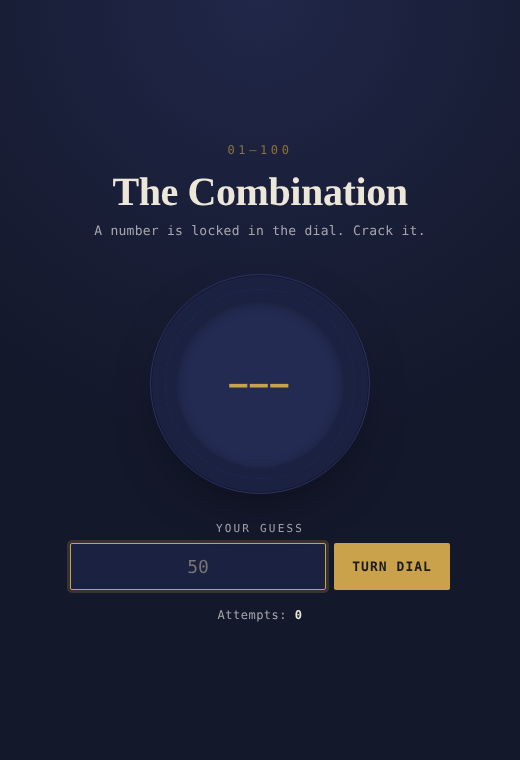
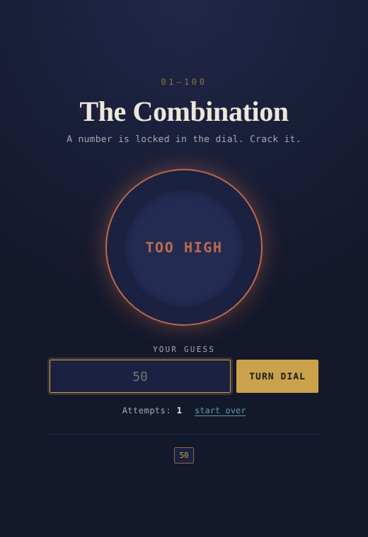
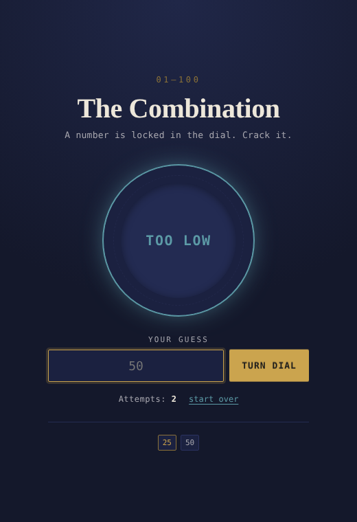
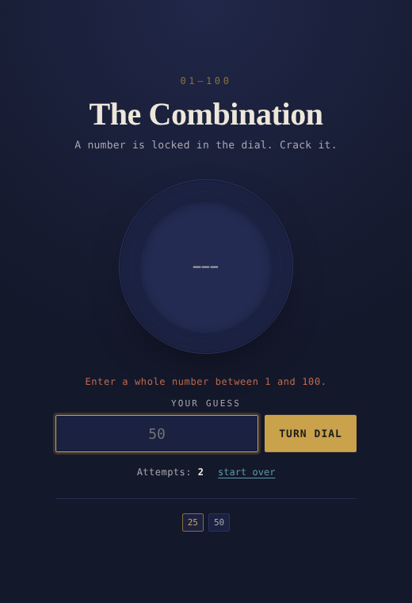
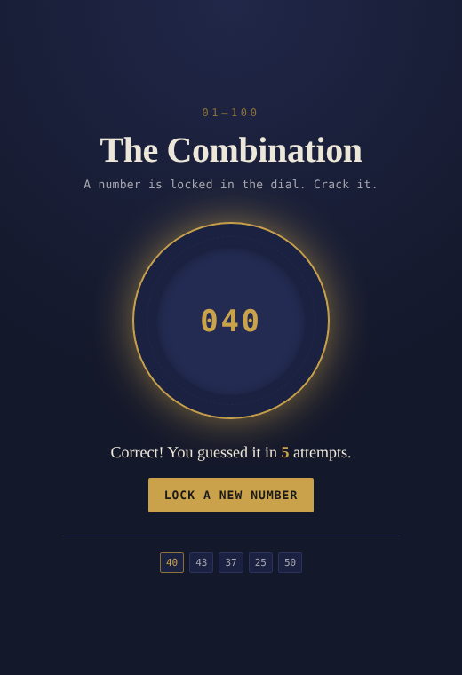

# Guess the Number Game

A PHP-based Guess the Number Game mini project developed using HTML, CSS and PHP.

## Student Details

**Name:** Bhoomi  
**Roll Number:** 2442952  
**Course:** Bachelor of Computer Applications (BCA), 5th Semester  
**Subject:** PHP  
**Project Name:** Guess the Number Game

## Project Objective

The objective of this mini-project is to develop a web-based Guess the Number Game using HTML, CSS and PHP.

The computer generates a random number between 1 and 100. The user enters guesses through an HTML form, and the application displays **Too High**, **Too Low** or **Correct** for each guess.

The application counts the total number of attempts and displays it when the user guesses the correct number.

## Features

- Generates a random number between 1 and 100.
- Accepts guesses through an HTML form.
- Displays "Too High" when the guess is greater than the number.
- Displays "Too Low" when the guess is smaller than the number.
- Displays "Correct!" when the number is guessed.
- Counts and displays the total number of attempts.
- Shows the history of all guesses made.
- Rejects invalid input (blank, text, decimals, or numbers outside 1–100).
- "Start over" option to begin a new game at any time.
- "Lock a new number" button to play again after winning.
- Responsive design that works on mobile and desktop.
- No database is used; the game state is stored in a PHP session.

## Algorithm

1. Start the program.
2. Start a PHP session.
3. If no game is running, generate a random number between 1 and 100 and set attempts to 0.
4. Display the guess input form.
5. Accept the guess from the user.
6. Check whether the guess is a whole number between 1 and 100. If not, display an error message and go to step 4.
7. Increase the attempt count by 1 and add the guess to the history.
8. If the guess is greater than the number, display "Too High" and go to step 4.
9. If the guess is smaller than the number, display "Too Low" and go to step 4.
10. If the guess is equal to the number, display "Correct!" with the total number of attempts.
11. If the user clicks "Lock a new number", go to step 3.
12. End.

## Flowchart

Start

↓

Generate Random Number (1–100), Attempts = 0

↓

Enter Guess

↓

Valid Number (1–100)? — No → Show Error → Enter Guess

↓ Yes

Attempts = Attempts + 1

↓

Compare Guess with Number

↓

Guess > Number → Too High → Enter Guess

Guess < Number → Too Low → Enter Guess

Guess = Number → Correct!

↓

Display Total Attempts

↓

End

## Technologies Used

- HTML5
- CSS3
- PHP
- XAMPP
- Apache Server

## Steps to Run

1. Install XAMPP.
2. Open the XAMPP Control Panel.
3. Start the Apache server.
4. Copy the project folder into the `htdocs` directory.
5. Open a web browser.
6. Enter:

   `http://localhost/2442952_GuessTheNumberGame/`

7. Enter a number between 1 and 100.
8. Click the **Turn Dial** button.
9. Follow the "Too High" / "Too Low" hints until the correct number is guessed.
10. Click **Lock a new number** to play again.

## Output Screenshots

### Start Page

### Too High

### Too Low

### Invalid Input

### Correct Guess

